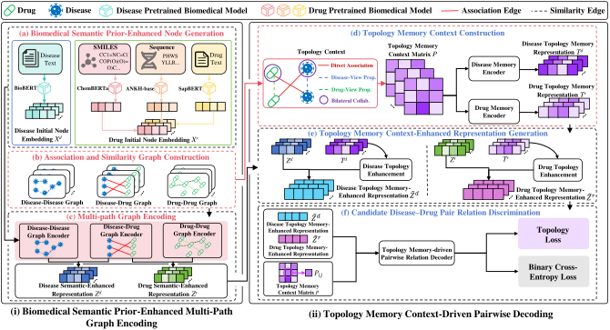

# TomBio

**TomBio: Topology Memory Context-Driven Association Prediction with Biomedical Semantic Prior Enhancement for Drug Repositioning**

TomBio is a drug repositioning framework for drug–disease association prediction. It combines biomedical semantic priors with multi-path graph learning and an explicit topology-memory-driven pairwise decoder.

## Framework



## Environment

Experiments were conducted with Ubuntu 22.04, Python 3.12.4, PyTorch 2.3.0, and CUDA 12.1.

```bash
conda create -n tombio python=3.12.4
conda activate tombio

# Install the CUDA 12.1 build of PyTorch 2.3.0
pip install torch==2.3.0 --index-url https://download.pytorch.org/whl/cu121

# Install other dependencies
pip install numpy scipy pandas scikit-learn
```

## Run the experiments

```bash
python main.py --dataset Gdataset
```

## Datasets

The benchmark datasets are available from the following repositories:

- **Gdataset and Cdataset:** [BNNR repository](https://github.com/BioinformaticsCSU/BNNR)
- **LRSSL:** [DRIMC repository](https://github.com/linwang1982/DRIMC)
